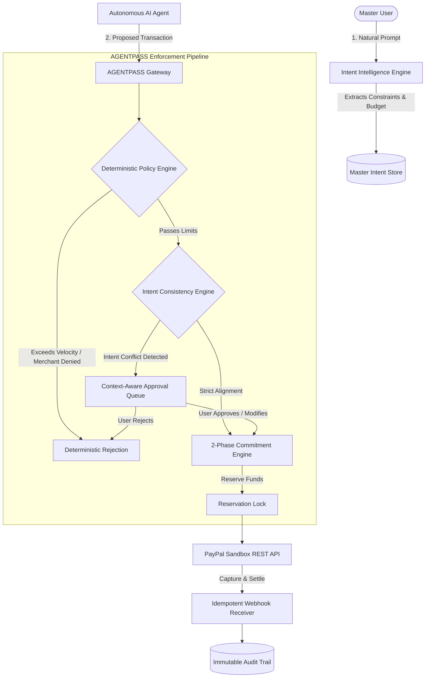

# 🛡️ AGENTPASS — AI Agent Financial Governance & Intent Rail

> **Deterministic Financial Execution & Semantic Intent Governance for Autonomous AI Agents**

[](https://fastapi.tiangolo.com)
[](https://www.postgresql.org/)
[](https://react.dev/)
[](https://www.typescriptlang.org/)
[](https://tailwindcss.com/)
[](https://developer.paypal.com)
[](https://pytest.org)

---

## 💡 The Core Problem AGENTPASS Solves

Autonomous AI agents (e.g., CrewAI, AutoGen, LangChain agents) increasingly operate with financial agency—ordering parts, reserving compute, booking flights, or purchasing products. However, existing payment architectures only enforce **amount-based thresholds** (e.g., *"Is this transaction under $500?"*).

### The Intent Failure Scenario
A user instructs an autonomous buyer agent:
> *"I need a laptop for college. Prioritize battery life and portability. Do not purchase gaming laptops."*

During autonomous search, the agent encounters a discounted **$999 RTX 4090 gaming laptop**. 
- Under traditional payment rails: **Approved** (because $999 is within the $1,000 budget).
- Under **AGENTPASS**: **Blocked instantly** because AGENTPASS performs semantic intent comparison, identifying a hard conflict with the negative constraint (*"gaming laptop"*).

AGENTPASS sits directly between autonomous AI agents and real payment rails (such as PayPal Sandbox), guaranteeing that **financial transactions are authorized only when they satisfy BOTH deterministic policy limits AND semantic user intent**.

---

## 🏛️ Architectural Pillars



### 1. Semantic Intent Intelligence
- Parses natural language prompts to extract primary goals, positive constraints, negative constraints, and budget ceilings.
- Calculates semantic consistency scores (`MATCH`, `DRIFT`, `HARD_CONFLICT`).
- Prevents prompt drift and vendor manipulation.

### 2. Microsecond Deterministic Policy Engine
- Hard spending limits (per-transaction, daily velocity, monthly ceilings).
- Merchant allowlists and blocklists.
- Prohibited category firewalls (e.g., Gaming Hardware, Crypto, Gambling, Luxury Goods).

### 3. Two-Phase Financial Commitments
- Solves multi-agent race conditions and double spending.
- Phase 1: **Reserve** — Locks budget allocation with TTL expiration.
- Phase 2: **Commit & Settle** — Executes PayPal capture and finalizes the ledger.

### 4. Delegation Chain Invariance & Provenance
- Tracks parent-to-child agent hierarchies with strict subset rules.
- Child sub-agents can never exceed parent spending ceilings or bypass category restrictions.
- Circular delegation cycle detection and max-depth enforcement.

### 5. Multi-Scope Emergency Kill Switch
- Instantly halts financial authorization across:
  - `global`: Freezes all autonomous agent activities platform-wide.
  - `delegation_tree`: Terminates a parent agent and all inherited child workers.
  - `agent`: Revokes individual agent API credentials.

### 6. PayPal Sandbox REST Rails & Idempotent Webhooks
- OAuth2 token retrieval, order creation (`intent: CAPTURE`), and settlement.
- Webhook processor for `PAYMENT.CAPTURE.COMPLETED` and `CHECKOUT.ORDER.APPROVED` with deduplication against `provider_event_id`.

---

## 📁 Repository Structure

```
Agent-Pass/
├── backend/
│   ├── app/
│   │   ├── api/v1/endpoints/    # 14 modular routers (auth, agents, permissions, intents, approvals, etc.)
│   │   ├── core/                # Security (argon2, JWT), config settings
│   │   ├── db/                  # Session, Base models
│   │   ├── models/              # 21 SQLAlchemy enterprise entities
│   │   ├── schemas/             # Pydantic v2 validation models
│   │   └── services/            # Intent Engine, Policy Engine, Commitment Engine, Kill Switch, PayPal
│   ├── tests/                   # 100% passing Pytest suite (unit + e2e)
│   ├── alembic/                 # Database migrations
│   ├── requirements.txt         # Pinned backend dependencies
│   └── Dockerfile               # Production container image
├── frontend/
│   ├── src/
│   │   ├── components/          # Reusable UI primitives (Card, Badge, Button, Modal, StatCard)
│   │   ├── pages/               # 11 complete dashboard views
│   │   ├── services/            # Centralized API service layer with Axios interceptors
│   │   ├── store/               # Zustand authentication state
│   │   └── types/               # TypeScript interfaces
│   ├── nginx.conf               # Production Nginx SPA configuration
│   ├── package.json             # React 18 + Vite + Tailwind + Recharts
│   └── Dockerfile               # Multi-stage production build
├── docker-compose.yml           # Full-stack orchestration (PostgreSQL + Redis + FastAPI + React)
└── .env.example                 # Configuration template
```

---

## 🚀 Quickstart Guide

### Option A: Local Development Setup

#### 1. Backend Setup (PowerShell / Windows)
```powershell
cd backend
python -m venv venv
.\venv\Scripts\Activate.ps1
pip install -r requirements.txt

# Run migrations & seed database
alembic upgrade head

# Start FastAPI server
uvicorn app.main:app --reload --port 8000
```
*Backend API docs available at: `http://localhost:8000/docs`*

#### 2. Frontend Setup
```powershell
cd frontend
npm install
npm run dev
```
*Web dashboard available at: `http://localhost:5173`*

---

### Option B: Docker Compose (All Services)

Run the full production stack with PostgreSQL 16, Redis 7, FastAPI, and Nginx:
```bash
docker-compose up --build
```
- **Web Dashboard**: `http://localhost:3000`
- **FastAPI Backend**: `http://localhost:8000`
- **Interactive Swagger Docs**: `http://localhost:8000/docs`

---

## 🧪 Verification & Testing

The backend includes comprehensive integration and unit test coverage:

```powershell
# Run all test suites
backend\venv\Scripts\pytest backend\tests -v

# Run code style & security linter
backend\venv\Scripts\ruff check backend\app backend\tests
```

**Test Coverage Highlights:**
- ✅ `test_e2e_journey.py`: End-to-end user registration, agent onboarding, policy enforcement, intent divergence interception, human approval, and PayPal capture.
- ✅ `test_intent_engine.py`: Semantic divergence detection blocking gaming hardware under college laptop prompts.
- ✅ `test_policy_and_killswitch.py`: Microsecond deterministic limits and single/multi-agent killswitch verification.
- ✅ `test_delegations_and_webhooks.py`: Circular delegation prevention, budget invariance, and PayPal webhook idempotency.

---

## 🛡️ Autonomous Agent Authentication

Autonomous agents authenticate using high-entropy API keys:
```http
POST /api/v1/transactions/
Host: api.agentpass.local
X-Agent-Key: agp_live_7f8c9b2e...
Content-Type: application/json

{
  "agent_id": "9b1deb4d-3b7d-4bad-9bdd-2b0d7b3dcb6d",
  "amount": 89.99,
  "currency": "USD",
  "merchant": "Apple Store",
  "payment_method": "paypal_sandbox"
}
```
*Raw keys are never stored; only SHA-256 hashes are persisted.*

---

## 📄 License
Apache License 2.0. Built for the era of autonomous AI agents.
