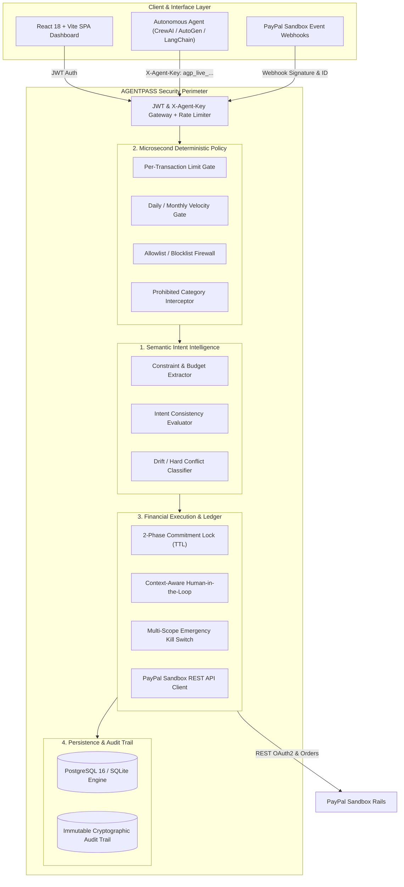
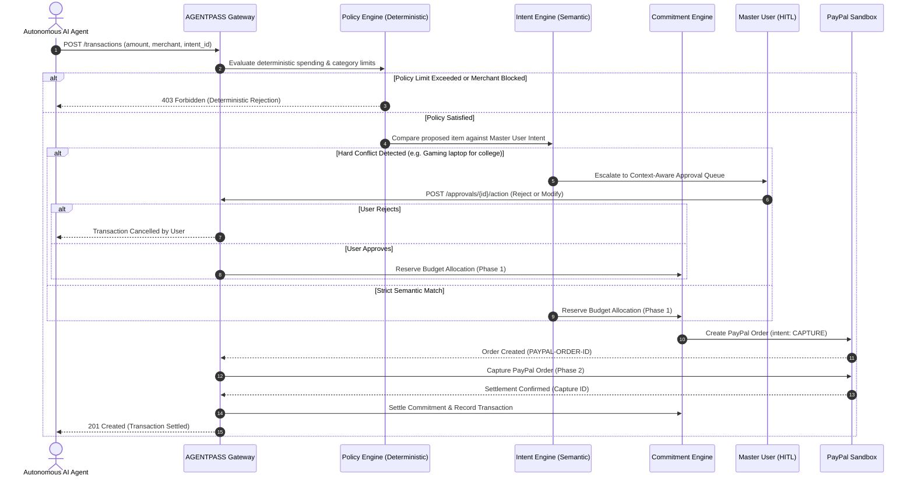

# 🏛️ AGENTPASS — Architecture & System Design

## 1. System Topology Overview

AGENTPASS is an intent-governed, non-custodial financial execution rail designed specifically for autonomous AI agents. It operates between the reasoning loops of AI frameworks (e.g., CrewAI, AutoGen, LangChain) and enterprise payment gateways (specifically PayPal Sandbox).

---

## 2. Core Execution Lifecycles

### A. Autonomous Transaction Evaluation Flow

---

## 3. Two-Phase Financial Commitments

When multiple autonomous agents operate concurrently under a shared corporate budget, race conditions can cause overspending:
1. **Phase 1: Reserve**: AGENTPASS issues a temporary cryptographic lock against the agent's spending pool with a strict 30-minute Time-To-Live (TTL).
2. **Phase 2: Commit & Settle**: Once the physical order is confirmed on payment rails, the commitment transitions to `settled`. If an order fails or times out, the lock is automatically `released`.

---

## 4. Multi-Agent Delegation Chains

AGENTPASS supports hierarchical agent structures (Root Agent $\rightarrow$ Sub-agent $\rightarrow$ Worker):
- **Invariance Rule**: An agent cannot delegate authority exceeding its own daily limit ($L_{\text{child}} \le L_{\text{parent}}$).
- **Inherited Negative Constraints**: All prohibited categories and merchants are transitively inherited down the delegation graph.
- **Cycle Prevention**: Circular loops ($A \rightarrow B \rightarrow C \rightarrow A$) are rejected with a cycle detection graph check before persistence.
